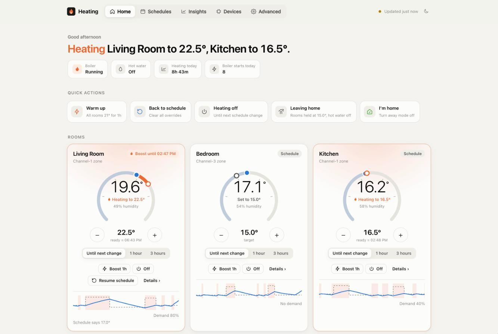
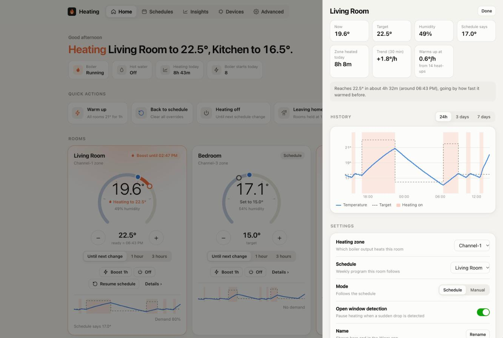
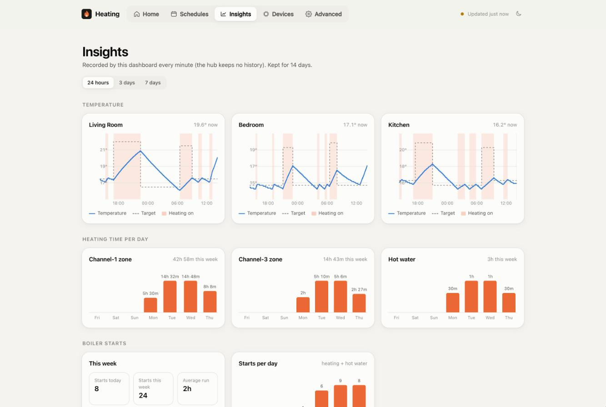
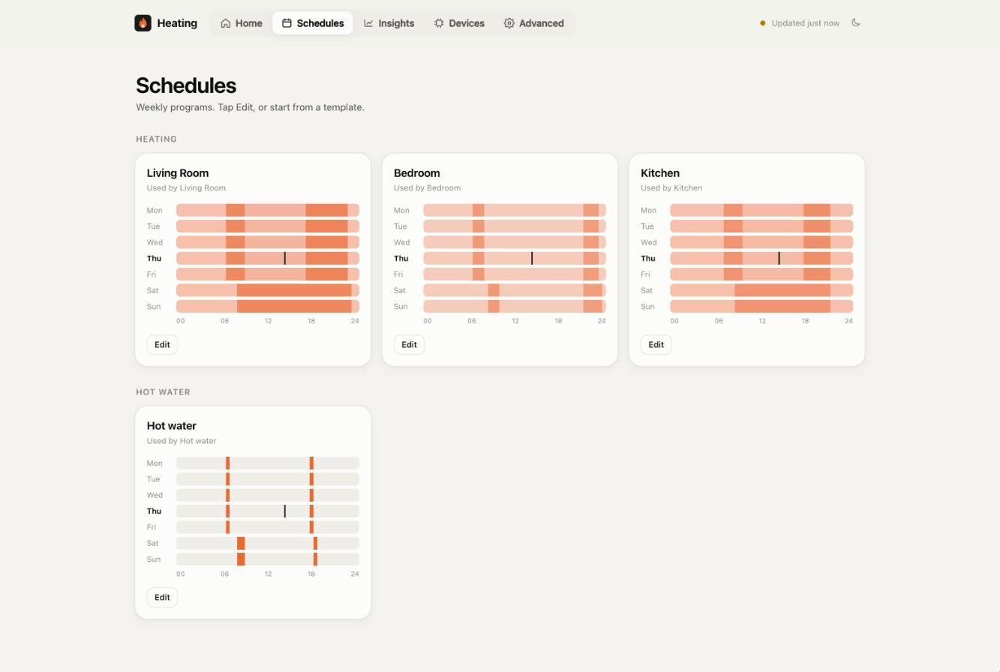
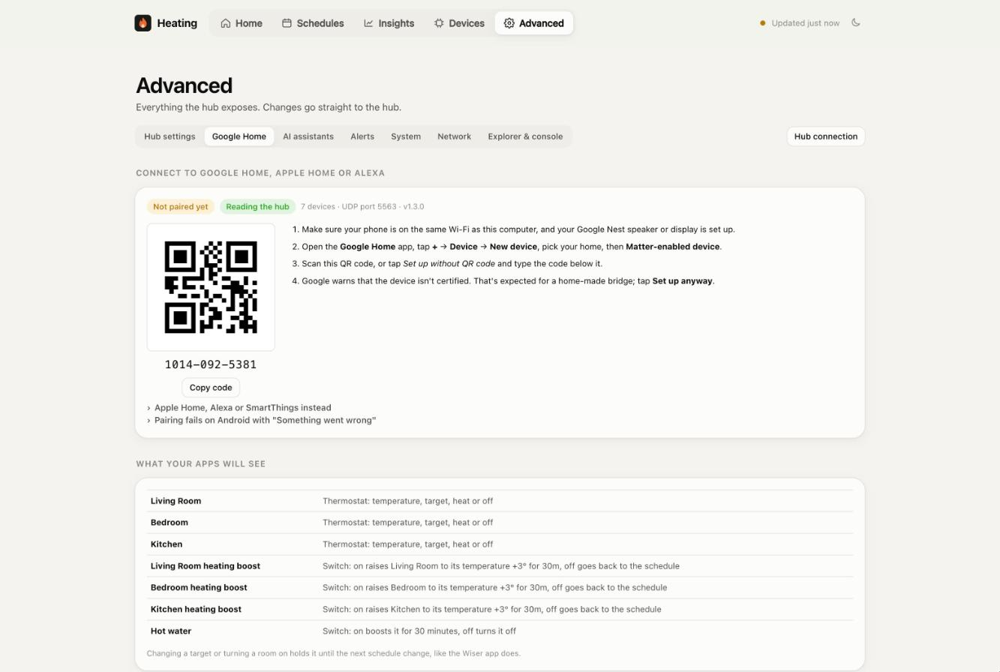
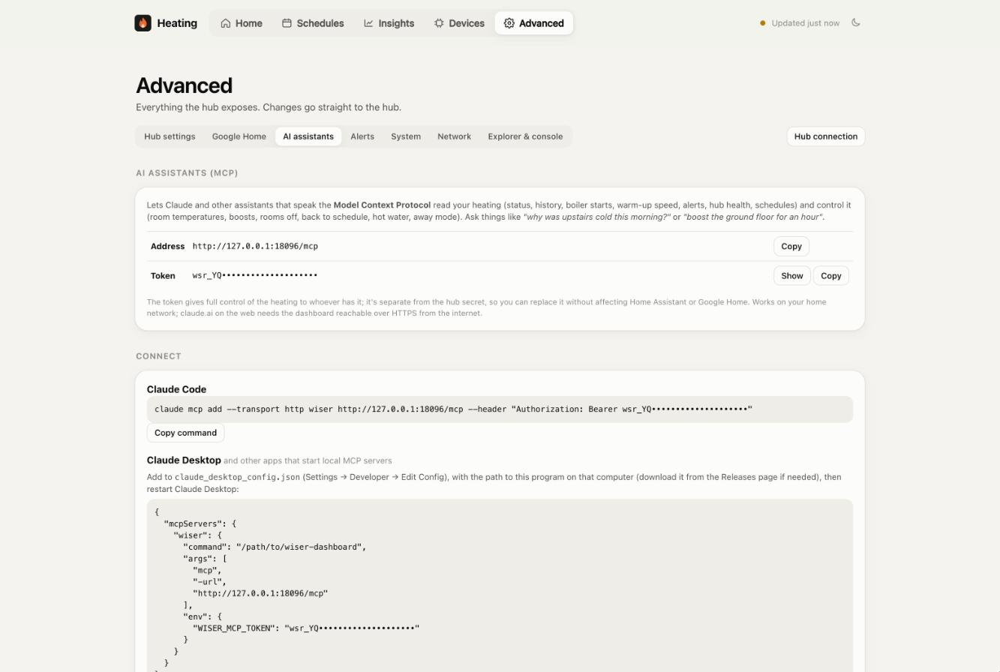

# Wiser Dashboard

**Your Wiser heating, under your control: local, fast, and connected to Google Home, Apple Home, Alexa,
Home Assistant and AI assistants.**

Wiser Dashboard is a single program that sits next to your Drayton / Schneider Electric **Wiser heating hub**
on your home network. It gives you a modern dashboard for your rooms, boiler and hot water, keeps a history the
hub itself never keeps, explains how your heating behaves, and makes the hub available to the apps and
assistants you already use. It talks to the hub locally: no cloud account, no subscription, nothing leaves your
home.

> One command installs it, then open `http://localhost:8080`. It finds your hub by itself.



---

## Why

The Wiser hub is a capable thermostat with a fragile network side. It answers **one request at a time**, about
**five seconds apart**, stalls on any response larger than ~2.7 KB, and on a weak Wi-Fi link drops most of its
traffic. The official app depends on the cloud, and Home Assistant's Wiser integration reads the hub's whole state
in one large request, which is exactly what a struggling hub can't deliver.

Wiser Dashboard is built around those limits. It talks to the hub the way the hub can cope with (small requests,
one at a time, commands ahead of polling), keeps a fresh copy of everything, and serves that copy instantly to the
dashboard, Home Assistant, Google Home and AI assistants, so none of them has to fight the hub directly.

## Highlights

| | |
|---|---|
| 🏠 **A dashboard you'll use** | Every room at a glance, one-tap boosts and scenes, a schedule editor, insights and every hub setting, on your phone or computer. |
| 📈 **History and insights** | 14 days of temperatures, heating time per day, **boiler starts and short cycling**, how fast each room warms up, and "ready at" estimates. |
| 🛡️ **Waste guard** | Opt-in. A room turned up by hand and forgotten goes back to its schedule after an hour of heating, whoever turned it up; boosts and timed holds are respected. Plus alarms for schedules that never switch off and for too much heating in 24 hours. |
| 🚨 **Alerts** | Hub offline, low batteries, weak signal, cold rooms, open windows, hub restarts, Wi-Fi trouble, wrong clock, and more, with phone notifications through Home Assistant. |
| 🩺 **Hub health** | The hub's Wi-Fi signal, retransmissions, drops and restarts, logged over time, so you can see when the problem is the network, not the heating. |
| 🔌 **Home Assistant, made reliable** | A drop-in, hub-compatible API that answers Home Assistant from the cache instantly, even when the hub's Wi-Fi is poor. |
| 🗣️ **Google Home, Apple Home, Alexa** | A built-in **Matter bridge**: rooms appear as thermostats, hot water and per-room **heating boost** switches as switches. Voice control, routines, Gemini, and control away from home, without Home Assistant. |
| 🤖 **Talk to your heating** | A built-in **MCP server** (beta), so Claude and other AI assistants can answer *"why was upstairs cold this morning?"* or *"boost the ground floor for an hour"*. |
| 📦 **One file, everywhere** | Windows, macOS, Linux and Raspberry Pi, installed with one command. No dependencies. Hardened Linux service and a firewall helper. |
| 🔄 **Keeps itself up to date** | Shows its version and new releases; update with one click, or opt in to automatic updates. Every update is **signature-verified**. |
| 🔒 **Private by design** | Everything stays on your network. Separate secrets for each kind of access, an optional dashboard password, and no cloud. |

## Screenshots

| | |
|---|---|
|  **A room in detail**: history, warm-up speed, "ready at" estimate and settings |  **Insights**: temperatures, heating time per day and boiler starts |
|  **Schedules**: every heating and hot water schedule at a glance, with an editor |  **Google Home, Apple Home, Alexa**: pair with a QR code |
|  **AI assistants**: ready-made setup for Claude Code and Claude Desktop | |

*Screenshots use demo data.*

---

## Features

### The dashboard

- **Home**: a plain-language summary ("Heating Upper Floor to 21°"), boiler and hot water state, heating time and
  boiler starts today, alerts, and **quick actions**: *Warm up* (all rooms 21° for an hour), *Back to schedule*,
  *Heating off*, *Leaving home* and *I'm home* (away mode).
- **Rooms**: temperature, target, whether it's heating, what set the target (schedule, boost, override, away) and
  until when, **"ready ≈"** times from the room's measured warm-up speed, one-tap boost, set-and-hold for 1 or 3
  hours, and a detail sheet with the room's history chart and *how the hub runs this room*.
- **Hot water**: on, off, boost, schedule, auto or manual mode.
- **Schedules**: a visual weekly editor for heating and hot water schedules, with copy to weekdays or to all days,
  rename, and assigning schedules to rooms.
- **Insights**: heating time per day, boiler starts and short runs, warm-up speed per room, and hub health.
- **Devices**: every thermostat and device with signal and battery, the hub, its Zigbee radio and what it can do,
  and an **Add a device** wizard (beta): pairing mode, the new device found, made to blink and attached to a room
  (a new one if needed), with the hub's acceptance checked.
- **Advanced**:
  - **Hub settings**: comfort mode, early-start limit, away temperature, hot water while away, valve protection,
    daylight saving, and the boiler setup for reference.
  - **Waste guard**: off, watch only or on; the time limit, what it covers, its alarms, and what it did.
  - **Google Home**: Matter pairing and boost switch settings.
  - **AI assistants**: MCP setup.
  - **Alerts**: alert settings, with a ready-made Home Assistant setup.
  - **System**, and **Network**: Wi-Fi trouble counters, networks the hub can see, router and setup network details.
  - **Explorer & console**: read and send anything the hub's API offers.
- Works on phones, has light and dark themes, and lets you give heating zones your own names.

### History, insights and alerts

The hub keeps no history, so the dashboard records one sample a minute and keeps 14 days. From it, it works out:

- **Boiler starts and short cycling** per day. Frequent short runs wear a boiler; this shows them.
- **Heating and hot water time** per day and per zone.
- **Warm-up speed** of each room (°C per hour), used for the "ready ≈" estimates.

**Alerts** watch for: the hub going offline, low batteries, weak signal, rooms below a minimum temperature, open
windows, hub restarts, Wi-Fi trouble, a wrong hub clock, changes stuck waiting for a device, away mode left on,
and schedules that never heat. Each kind can be turned off, the minimum temperature is yours to set, and
`GET /api/alerts` with the ready-made Home Assistant sensor sends them to your phone.

### Waste guard

Most wasted heating isn't the schedule: it's a room turned up by hand and forgotten. The waste guard (off by
default, **Advanced → Waste guard**) watches every room and the hot water, whoever changed them: the Wiser app, a
thermostat dial, Home Assistant, Google Home, an AI assistant or the dashboard itself.

- A room whose target is **above what its schedule last set**, with no end chosen, may heat for **60 minutes**
  (yours to set); then it goes back to the schedule's value. The room's mode never changes. A room without a
  schedule goes to a temperature you choose (10° by default). Hot water switched on by hand works the same way.
- **Left alone**: the schedule, comfort mode's early start, boosts and other timed changes, away mode, open windows,
  and anything turned down.
- **Keep for another hour** on the room card restarts the timer; so does turning it up again.
- **Watch only** mode logs what it would have done, to try the rules on your house first.
- **Alarms** (they never change anything): a schedule that keeps a room on for more than 12 hours, and more than
  12 hours of heating in the last 24, with the figure shown large on the home page.
- Its alerts reach the dashboard, Home Assistant, and Google Home, Apple Home and Alexa through a **Heating alert**
  contact sensor that opens while one is active; optionally with devices named with the alerts, and the last 24
  hours' heating as a temperature sensor.
- A **14-day trend** of the heating time in any 24 hours, with your limit.

The rules and how they work are in [docs/waste-guard.md](docs/waste-guard.md).

**Hub health** logs the hub's Wi-Fi signal, TCP retransmissions, disconnects, failed reconnects, memory and
restarts, so a flaky hub can be diagnosed with evidence.

### Home Assistant, made reliable

The dashboard serves the hub's own API under `/data/` on its port. Point Home Assistant's Wiser integration at the
dashboard instead of the hub:

- Full-state reads (domain, network, schedules, status, OpenTherm) are answered **instantly from the cache**.
- Commands go to the hub **ahead of polling**, and the cache updates from the hub's reply, so the next read shows
  the change.
- It accepts the **hub's own secret**, always the one the dashboard uses, and nothing else.

In Home Assistant, add the Wiser integration manually: **Host** = this machine's IP, **Port** = `8080`,
**Secret** = the hub secret. Ignore the hub if Home Assistant discovers it directly. The dashboard password
doesn't apply to `/data/`.

### Google Home, Apple Home, Alexa and SmartThings (Matter)

A built-in Matter bridge puts your heating into the smart-home apps directly, **without Home Assistant**:

| In your app | What it does |
|---|---|
| **Each room**, as a thermostat | Temperature, target and heat/off. A new target holds until the schedule's next change. |
| **Hot water**, as a switch | On boosts it for 30 minutes; off turns it off until the schedule's next change. Shows whether it's actually heating. |
| **Heating alert**, as a contact sensor (while the waste guard is on) | Opens while one of the waste guard's alerts is active, so Apple Home can notify you and Google Home or Alexa routines can start on it. Optionally, up to three more sensors named with the alerts themselves (*Lounge back to 16°*), there while each is active. |
| **Heating hours (last 24h)**, as a temperature sensor (option) | The last 24 hours' heating time as degrees: 13.5° is 13.5 hours. |
| **"<Room> heating boost"**, as a switch per room | On raises the room to **its current temperature + 3°** (never below its target) for **30 minutes**; off returns it to the schedule. Shows on while the hub is boosting, however the boost was started. Length, increase and which rooms get one are set on the Google Home page. |

- **Voice and Gemini**: *"Hey Google, set Ground Floor to 21"*, *"turn on Upper Floor heating boost"*. For a phrase
  of your own, like *"boost ground floor heater"*, the dashboard explains the one-time Google Home routine.
- **Away from home** through your Google Nest speaker or display, Apple home hub or Echo.
- **Pairing**: scan the QR code under **Advanced → Google Home** (Google Home: **+ → Device → New device →
  Matter-enabled device**). Pairing survives restarts and upgrades; the same page lists paired apps and can
  remove them.
- **No extra load on the hub**: the bridge works from the dashboard's cache and queue, with the hub secret.
- Ports: UDP 5540 and mDNS (UDP 5353). `-matter-port` changes the port, `-matter=false` turns it off.
- The bridge (`matter/`, TypeScript on [matter.js](https://github.com/project-chip/matter.js), compiled with Bun)
  is packed inside the dashboard, which unpacks and supervises it. That's why downloads are 30–40 MB.

### AI assistants (MCP, beta)

The MCP server is new and still in beta: it works and is tested, but its tools may change as people use it.
The dashboard is an [MCP](https://modelcontextprotocol.io) server at `http://<this-machine>:8080/mcp`, so
Claude and other AI assistants can read and control the heating with real data:

- **Read**: `get_status`, `get_history` (up to 14 days), `get_boiler_cycles`, `get_warmup_rates`, `get_alerts`,
  `get_hub_health`, `get_schedules`.
- **Control**: `set_room_temperature`, `boost_room`, `room_off`, `resume_schedule`, `hot_water` (boost, on, off,
  schedule), `set_away_mode`.
- **Safe by default**: changes are overrides (for some minutes or until the schedule's next change) within 5–30°,
  bad input is refused before it reaches the hub, and control tools are marked as such, so assistants ask first.
  Every change goes through the same queue as the dashboard, so all apps stay in sync.
- **Its own token**, separate from the hub secret, made on first start and shown, copyable and replaceable
  under **Advanced → AI assistants**, with ready-made setup:

```sh
# Claude Code
claude mcp add --transport http wiser http://<this-machine>:8080/mcp --header "Authorization: Bearer <token>"
```

Apps that only start local MCP servers (like Claude Desktop) run the same program as a relay:
`wiser-dashboard mcp -url http://<this-machine>:8080/mcp`, with the token in `WISER_MCP_TOKEN`. `-mcp=false`
turns the MCP server off.

### Updates

The version is always shown at the top of the page. The dashboard checks GitHub for a new release every 6 hours
and shows **Update available** when there is one. Under **Advanced → System → Updates** you can see what's
new, click **Update now**, or opt in to **Install updates automatically** (off by default).

Releases are **signed**: CI signs each release's `SHA256SUMS.txt` with the project's Ed25519 key, kept only as
a GitHub secret, and the program has the public keys built in (`internal/releasekeys`, a main key and a spare
for rotation). An update downloads the release for your system, **refuses it unless the signature verifies**,
checks the download against the signed checksums, makes sure the new program starts and reports the right
version, and only then replaces the old one and restarts. Even someone who took over the GitHub account or the
download path couldn't push an update without the private key. The install command checks the signature too
where OpenSSL 3 is available (most Linux). Settings, history, pairings and
tokens stay. Installs made with the install command update themselves:

- **Linux service:** the service is locked down and can't change its own program, so a small root helper
  (`wiser-dashboard-update.path` / `.service`, set up by the installer) installs the update and restarts it.
- **macOS, Windows and per-user installs:** the dashboard replaces its own program and restarts.
- **Other installs** (e.g. a service set up by hand without the helper): the page shows the install command,
  which upgrades in place.

### Easy to run, built properly

- **One file** for Windows, macOS, Linux (x86-64, arm64) and Raspberry Pi. No installer, no runtime.
- **Finds the hub by itself** and asks for anything missing in the browser.
- **Linux service**: a hardened systemd unit (its own user, no access to your home folder, a restricted set of
  system calls) and **`open-firewall.sh`**, which works out your network and opens only what's needed, only to it.
- **Tested on every change**: GitHub Actions checks Linux, macOS and Windows, pairs a **real Matter controller**
  with the bridge against a mock hub, runs the MCP tests, and builds and packages every platform. Releases come
  with SHA-256 checksums.
- **One build script** (`go run ./tools/build`) that works identically on every system.

---

## Get started

**One command** installs the latest release, checks the download's checksum, sets it up to start
automatically and confirms it's running:

```sh
# Linux, macOS, Raspberry Pi
curl -fsSL https://raw.githubusercontent.com/shenhab/wiser-dashboard/main/install.sh | sh
```

```powershell
# Windows (PowerShell)
irm https://raw.githubusercontent.com/shenhab/wiser-dashboard/main/install.ps1 | iex
```

- **Linux with systemd** gets the locked-down system service (it asks for your password via `sudo`) and its
  firewall opened to your local network only. A copy you ran by hand before is carried over: settings,
  history and Google Home pairing.
- **macOS** gets a login item for your user; **Windows** starts minimized at login and, when run as
  administrator, is allowed through the firewall on private networks. Other systems get a per-user install.
- **Run it again to upgrade**; settings, history, pairings and tokens are kept. Options go after
  `sh -s --`: `--version v1.3.1`, `--hub 192.168.1.50`, `--port 9090`, `--no-service`, `--no-firewall`,
  `--uninstall` (add `--purge` to delete settings too). The hub secret can be given as `WISER_SECRET=...`;
  otherwise the dashboard asks for it. On Windows, set `$env:WISER_VERSION`, `$env:WISER_HUB`,
  `$env:WISER_PORT`, `$env:WISER_SECRET` or `$env:WISER_UNINSTALL = "1"` first.

Prefer to do it by hand?

1. **Download** the archive for your system from the [Releases](../../releases) page and unpack it.
   Linux: match `uname -m` (`x86_64` → amd64, `aarch64` → arm64, `armv7l` → armv7).
2. **Run** `wiser-dashboard` (`wiser-dashboard.exe` on Windows).
3. **Open** `http://localhost:8080`, or the address it prints, from any device on your network.

It finds your hub and asks for the hub **secret** if it can't fetch it (see
[How it finds the hub](#how-it-finds-the-hub-and-secret)). Settings are saved to your system's config folder
(`wiser-dashboard/config.json`, readable only by you). `./wiser-dashboard -version` shows the version.

| Flag | Meaning |
|---|---|
| `-listen :8080` | Address to serve on |
| `-hub IP` | Hub address (skips discovery) |
| `-secret` / `-secret-file` | Hub secret |
| `-password` | Require a password for the dashboard (any username); also `WISER_DASHBOARD_PASSWORD` |
| `-no-discover` | Don't scan the network at startup |
| `-config PATH` | Where to keep settings, history and logs |
| `-matter=false`, `-matter-port` | Turn off the Matter bridge / change its UDP port (5540) |
| `-mcp=false` | Turn off the MCP server |

**Anyone who can open the dashboard can control the heating.** Use `-password` if your network isn't trusted.

### Run as a service (Linux)

`deploy/wiser-dashboard.service` (also in the Linux downloads) runs it at boot as its own locked-down user and
restarts it if it stops. From the unpacked archive:

```sh
sudo useradd --system --no-create-home --shell /usr/sbin/nologin wiser-dashboard
sudo install -m 755 wiser-dashboard /usr/local/bin/
sudo install -m 640 -g wiser-dashboard ~/wiser_secret.txt /etc/wiser-dashboard.secret
sudo install -m 644 wiser-dashboard.service /etc/systemd/system/
sudo systemctl enable --now wiser-dashboard
sudo ./open-firewall.sh                 # only if the machine has a firewall
journalctl -u wiser-dashboard -f        # its log
```

Config, history, logs and Matter pairing live in `/var/lib/wiser-dashboard`. To keep them from an earlier
install, stop the service, copy the old config folder's contents there, run
`sudo chown -R wiser-dashboard: /var/lib/wiser-dashboard`, and start it again. A dashboard password goes in
`/etc/wiser-dashboard.env` as `WISER_DASHBOARD_PASSWORD=...`. To upgrade, install the new binary over
`/usr/local/bin/wiser-dashboard` and `sudo systemctl restart wiser-dashboard`; pairings and settings stay.

### Firewall

It needs TCP 8080 (dashboard, Home Assistant, MCP), UDP 5540 (Matter) and UDP 5353 (mDNS) from your home network.

- **Linux:** `sudo ./open-firewall.sh` works out your local network, finds the firewall in use (ufw, firewalld or
  nftables) and opens those ports to the local network only. `--dry-run` shows what it would do; pass a network
  (`192.168.1.0/24`) to choose it yourself. Safe to run again.
- **Windows:** allow **Private networks** when Windows asks on first start.
- **macOS:** allow incoming connections if the firewall is on, and **Local Network** access when asked; Matter
  needs it.

### How it finds the hub and secret

- **Hub:** scans each local /24 network for port 80 answering `401 {"Error":"Unauthorized"}` (the hub doesn't
  advertise itself), then confirms with the secret.
- **Secret:** tries `GET /secret`, which Wiser hubs only answer in setup mode, from their own Wi-Fi at
  `192.168.8.1`. Otherwise paste it on the setup page.

### Hub quirks it works around

- **One connection at a time, about 5 s apart:** every request goes through one queue, commands ahead of polling.
- **Responses over ~2.7 KB stall** (the hub resends most TCP segments), so `/data/domain/` is never fetched
  whole; sections are polled individually and assembled in the cache.

---

## Build and release

One script builds on Windows, macOS and Linux alike. It needs only [Go](https://go.dev/dl/); with
[Node.js](https://nodejs.org) installed it also builds and embeds the Matter bridge, installing its
dependencies itself.

```sh
go run ./tools/build                       # this machine -> ./wiser-dashboard (.exe on Windows)
go run ./tools/build -all                  # every platform -> dist/
go run ./tools/build -target linux/arm64   # chosen platforms (comma-separated) -> dist/
go run ./tools/build -all -package         # release archives (.tar.gz / .zip) -> dist/
go run ./tools/build -matter=off           # without the Matter bridge (-matter=on: fail without Node.js)
```

`./build.sh` (macOS, Linux) and `build.cmd` (Windows) are shortcuts for the same. Plain
`go build -o wiser-dashboard .` gives a build without the Matter bridge.

Tests: `go test ./...` (MCP server), and from `matter/` after a build, `node test/e2e.mjs
dist/wiser-matter-<os>-<arch>` (the bridge with a real Matter controller) and `node test/system.mjs
../wiser-dashboard` (the whole app). GitHub Actions (`.github/workflows/ci.yml`) runs all of them on Linux, macOS
and Windows for every push and pull request, then builds and packages every platform. A version tag publishes a
release:

```sh
git tag v1.4.0 && git push origin v1.4.0   # a tag with a dash, like v1.4.0-rc1, is marked pre-release
```

See [CONTRIBUTING.md](CONTRIBUTING.md) to propose changes.

---

## Limitations, and what could be done

Honest notes on what it doesn't do yet, with the way forward for each.

| Limitation | What could be done |
|---|---|
| **Tested on one setup**: a first-generation Wiser hub (WT734R1S0902, firmware 3.18.3) with a relay-controlled gas boiler and two rooms. OpenTherm boilers, smart plugs, shutters, lights and radiator valves are shown, but with little dedicated control. | Testing with more hubs and devices, and dedicated controls for them, as owners report what they have. |
| **The hub secret** is only fetched automatically in the hub's setup mode; otherwise it has to be pasted. That's the hardest step for non-technical users. | A guided setup page that walks through putting the hub in setup mode. |
| **One hub** per dashboard. | Support for several hubs. |
| **No HTTPS, and no password by default.** It's meant for a trusted home network; secrets travel over plain HTTP there. | Built-in HTTPS (e.g. a local certificate), and a password on by default. |
| **claude.ai on the web** can't reach it without exposing it to the internet over HTTPS. MCP access is a single token, with no OAuth or per-assistant permissions. | OAuth for MCP, a read-only token option, and a guide for safe remote access (a tunnel or Home Assistant's remote access). |
| **MCP can't edit schedules.** | Schedule tools with a preview and confirm step. |
| **Matter isn't certified**, so apps warn when pairing. Google Home has no native "boost" control, so boosts are switches, and custom phrases need a Google routine. Hot water boost from Google is fixed at 30 minutes. | Certification would need a vendor ID and fees. A configurable hot water boost length, and extra hot water switches, are straightforward. |
| **Matter on Android** sometimes fails to pair ("Something went wrong") because of an Android bug; pairing once from an iPhone or iPad works around it. Matter needs the phone, the dashboard and the smart-speaker hub on the same network, with mDNS. | Better diagnostics on the Google Home page for network problems. |
| **No Matter on 32-bit Raspberry Pi OS** (armv7): Bun, which runs the bridge, doesn't support it. | Use the 64-bit OS; or a native Go Matter implementation (weeks of work). |
| **Downloads are 30–40 MB**, because the bridge carries its own JavaScript runtime. | A native Go Matter bridge would bring them back to ~8 MB. |
| **The first install trusts GitHub over HTTPS.** Every update after it is signature-checked by the program, but the install command can only check the signature with OpenSSL 3 (most Linux), not on macOS or Windows; and updating *to* the first signed release from an older one relies on its checksums. | Verifying the first download with a key you get separately (e.g. from the README on a fork you trust). |
| **Unsigned programs**: macOS Gatekeeper and Windows SmartScreen warn on first start. | Code signing (Apple Developer ID, a Windows signing certificate) in the release pipeline. |
| **History starts when the dashboard starts** and covers 14 days; nothing is kept while it isn't running. | Longer retention or export to a time-series database. |
| **No app icon or background mode**: it's a program you leave running (or a Linux service). | A macOS app bundle, a Windows tray icon and a "start at login" option; an installable web app for phones. |

---

## Credits

**Author: Mahmoud Alshinhab ([@shenhab](https://github.com/shenhab))**: *"I didn't code it, I clauded it."*
The author set the goals, made the decisions and tested every feature on a real Wiser hub;
**[Claude](https://www.anthropic.com/claude)** (Anthropic), working in Claude Code, wrote the code, the tests
and the documentation.

Built on [matter.js](https://github.com/project-chip/matter.js) (Apache-2.0) and [Bun](https://bun.sh) for the
Matter bridge; everything else is Go's standard library.

**Licence:** [MIT](LICENSE). Use it, change it and share it freely; keep the copyright notice.

*Wiser, Drayton and Schneider Electric are trademarks of their owners. This is an independent project, not
affiliated with or endorsed by them. It controls real heating equipment: use it with care.*
